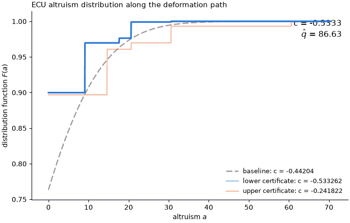

# Directed sensitivity: DLM2012

The object of interest is the ECU welfare effect of a visit without a flyer, $`c(F) = h_0 \int u_k \mathrm{d}F`$, per household approached; the criterion is the DLM (2012) minimum-distance objective $\hat q(F)$ over 70 moments, with all scalars held at $\hat\theta$; the working model is the censored normal family $`F_{\mu,\sigma}`$; and the nesting model is every distribution on $`[0, \bar a_k]`$ made of an atom at zero and a density.
The filled template is [`../filled_template.md`](../filled_template.md); the code of this run is [`run.py`](run.py), [`reduction.py`](reduction.py) and [`lean_instance.py`](lean_instance.py), and its outputs are [`certificates.json`](certificates.json), [`animation.gif`](animation.gif), [`certificates.png`](certificates.png), [`lean/DLM2012.lean`](lean/DLM2012.lean) and this report.
The workflow was run by Claude Code on Claude Opus 5.5 (`claude-opus-5-5`) on 2026-10-14.

## 1. Results

| Direction | Object $c$ | Criterion $\hat q$ | Verified feasible? | Origin | Exact inf/sup? |
|---|---|---|---|---|---|
| Baseline | -0.442 | 86.6 | Yes | N/A | N/A |
| Lower | -0.533 | 86.6 | Yes | Analytic exploration | Yes |
| Upper | -0.242 | 86.6 | Yes | Analytic exploration | Yes |



## 2. Analytic exploration

Split $`[0, \bar a_k]`$ into the regions $`R_0 = [0, a^{--}_k]`$, $`R_1 = (a^{--}_k, a^0_k]`$, $`R_2 = (a^0_k, a^-_k]`$, $`R_3 = (a^-_k, a^+]`$, $`R_4 = (a^+, g_i + 20]`$, $`R_5 = (g_i + 20, g_i + 50]`$ and $`R_6 = (g_i + 50, \bar a_k]`$.
For $F \in \mathcal{N}$ let $`p_j = F(R_j)`$, $`H_j = \int_{R_j} h^{\ast}_k \mathrm{d}F`$ and $`U_j = \int_{R_j} u_k \mathrm{d}F`$, and write $z = (p, H) \in \mathbb{R}^{14}$.
The budget is $\bar q = 86.6322$, at the refitted baseline of [Judgement calls](#5-judgement-calls).

1. **Reduction.** For every $F \in \mathcal{N}$, the 22 ECU moments equal $b + Az$ for a fixed vector $b$ and matrix $A$, so $\hat q(F) = Q(z)$ for a convex quadratic $Q$, and $`c(F) = h_0 \sum_j U_j`$.
   The closure of the set of $(p, H, U)$ that $\mathcal{N}$ produces is the polyhedron $\mathcal{K}$ given by $p \ge 0$, $`\sum_j p_j = 1`$, $`H_j = h_0 p_j + \eta U_j`$ with $`h^{\ast}_k(\underline a_j) p_j \le H_j \le h^{\ast}_k(\bar a_j) p_j`$ for $j \le 4$, where $`\underline a_j`$ and $`\bar a_j`$ are the ends of $`R_j`$; for $j = 5$, $`(H_5, U_5) / p_5`$ in the triangle with vertices $`(h^{\ast}_k(\underline a_5), u_k(\underline a_5))`$, $(1, u^{\ast})$, $`(1, u_k(\bar a_5))`$, where $`u^{\ast} = (1 - h_0)/\eta`$; and $`H_6 = p_6`$ with $`u_k(\underline a_6) p_6 \le U_6 \le u_k(\bar a_k) p_6`$.
2. **Exact supremum.** $`\sup c = \max \lbrace c_U(z) : z \in \mathcal{K}, Q(z) \le \bar q \rbrace = -0.242`$, where $`c_U`$ is $c$ with $`U_5`$ and $`U_6`$ at their largest values given $(p, H)$.
   The maximizer puts mass $0.897$ in $`R_0`$, $0.0639$ at $`a^0_k`$, $0.00903$ at $a^+$, $0.0234$ at $`g_i + 20`$ and $0.00685$ at $`g_i + 50`$, and no feasible $F \in \mathcal{N}$ attains the supremum.
3. **Exact infimum.** $`\inf c = \min \lbrace c_L(z) : z \in \mathcal{K}, Q(z) \le \bar q \rbrace = -0.533`$, where $`c_L`$ is $c$ with $`U_5`$ and $`U_6`$ at their smallest values given $(p, H)$.
   The minimizer puts mass $0.900$ in $`R_0`$, and $0.0699$, $0.00663$, $0.0228$ and $0.00089$ just above $`a^{--}_k`$, $`a^-_k`$, $a^+$ and $`g_i + 20`$; no feasible $F \in \mathcal{N}$ attains the infimum.

Proofs are in the [Appendix: proofs](#appendix-proofs).
[`lean/DLM2012.lean`](lean/DLM2012.lean) compiled with no `sorry` and no axioms of its own.
For the problem in $z$ of Claims 2 and 3, with the data written as exact decimals of the double-precision values, it proves `upper_enclosure`: the supremum lies in $[-0.2418203269, -0.2418203237]$; and `lower_enclosure`: the infimum lies in $[-0.5332625539, -0.5332625520]$.
The reduction of Claim 1 and the non-attainment statements are not formalized.

## 3. Basis model

Let $`\hat\nu_{+}`$ and $`\hat\nu_{-}`$ be the atom at zero of mass $`p_0`$ plus, for each further mass point of the maximizer of Claim 2 or the minimizer of Claim 3, a uniform density of that mass on an interval of width $\delta = 10^{-4}$ inside the point's region and ending at the point.
Then

```math
\mathcal{B} = \left\lbrace \beta_{w,\mu,\sigma} = |w| \hat\nu_{\mathrm{sgn}(w)} + (1-|w|) F_{\mu,\sigma} : w \in [-1,1], \mu \in \mathbb{R}, \sigma > 0 \right\rbrace .
```

## 4. Numerical decisions

- The anchors use width $\delta = 10^{-4}$; at $w = \pm 1$ they are within $1.9 \times 10^{-6}$ of the analytic values and $1.4 \times 10^{-5}$ or more inside the budget, so the reported certificates are the anchors themselves.
- The generalized reduced gradient solver was capped at 15 iterations per direction; it moved toward the anchors, reaching $w = 0.99995$ and $w = -0.9999996$, but did not converge or improve on them.

## 5. Judgement calls

- Holding $\hat\theta$ fixed, a Nelder–Mead search over $(\mu, \sigma)$ found $(-11.82, 16.47)$, with criterion $86.6322$ against $86.6334$ at the published $(-11.79, 16.46)$; this point is the baseline and sets the budget.
- The nesting-model checks are those of `specification.py:ConstraintSet` (density nonnegative on a 4001-point grid plus the anchor knots, total mass within $10^{-9}$ of one), at zero feasibility tolerance.

## 6. Evaluation spend

Criterion 637 of 20,000; target 263 of 50,000.

## Appendix: proofs

**Claim 1.** The moments in the filled template integrate $`\mathbf{1}_A`$ and $`h^{\ast}_k \mathbf{1}_A`$ against $F$, where $A$ ranges over the bins, $`(a^{--}_k, \infty)`$, $`(a^0_k, \infty)`$ and $`[0, a^0_k]`$.
Each such $A$, intersected with $`[0, \bar a_k]`$, is a union of the regions $`R_j`$, so every moment is affine in $z$; the map was checked against `specification.py:Moments` at the baseline to $1.5 \times 10^{-14}$.
On $`[0, \bar a_k]`$, $`h^{\ast}_k = \min \lbrace 1, h_0 + \eta u_k \rbrace`$, which never falls below $0.356$; $`u_k`$ is constant on $`R_0`$ and continuous and strictly increasing on each other region, and $`h^{\ast}_k`$ reaches one only inside $`R_5`$, at $a = 32.6$.
So within a region the pair $`(h^{\ast}_k, u_k)`$ traces a segment for $j \le 4$, a broken line with the triangle above as its convex hull for $j = 5$, and a horizontal segment for $j = 6$.
The image of the measures on $`R_j`$ is the cone over that convex hull, up to its boundary: atoms at $a > 0$ are excluded, but narrow densities approach them.

**Claim 2.** Over $\mathcal{K}$, $c$ is largest given $(p, H)$ when $`U_5`$ lies on the triangle's edge from $`(h^{\ast}_k(\underline a_5), u_k(\underline a_5))`$ to $`(1, u_k(\bar a_5))`$ and $`U_6 = u_k(\bar a_k) p_6`$, which makes $`c_U`$ linear in $z$.
The problem of Claim 2 then maximizes a linear function over a polyhedron intersected with the convex set $\lbrace Q \le \bar q \rbrace$.
A KKT point $z^{\ast}$ gives the value $-0.24182032480$; the Lagrangian with multiplier $0.0133$ on the budget and nonnegative multipliers on the active linear constraints is maximized in closed form, which bounds the value from above by $-0.24182032480$, a gap below $10^{-12}$.
Because $Q$ is strictly convex on the affine hull of $\mathcal{K}$ and the budget multiplier is positive, the maximizer is unique.
Take $`z_{\tau} = (1 - \tau) z^{\ast} + \tau z_{\min}`$, where $`z_{\min}`$ minimizes $Q$ over $\mathcal{K}$, with $`Q(z_{\min}) = 83.1 < \bar q`$.
Then $`Q(z_{\tau}) < \bar q`$, and narrow densities give primitives in $\mathcal{N}$ whose $(z, c)$ tend to $`(z_{\tau}, c_U(z_{\tau}))`$; letting $\tau \to 0$ gives the supremum.
It is not attained, because $`p_1 > 0`$ with $`H_1 = h^{\ast}_k(a^0_k) p_1`$ forces an atom at $`a^0_k > 0`$.

**Claim 3.** This is symmetric to Claim 2, with $`U_j = (H_j - h_0 p_j)/\eta`$ for $j \le 5$ and $`U_6 = u_k(\underline a_6) p_6`$.
The KKT value and the dual bound agree at $-0.53326255288$, with gap $9 \times 10^{-14}$.
The value is not attained: $`p_1 > 0`$ with $`H_1 = h^{\ast}_k(a^{--}_k) p_1`$ requires mass at the excluded left end of $`R_1`$.
