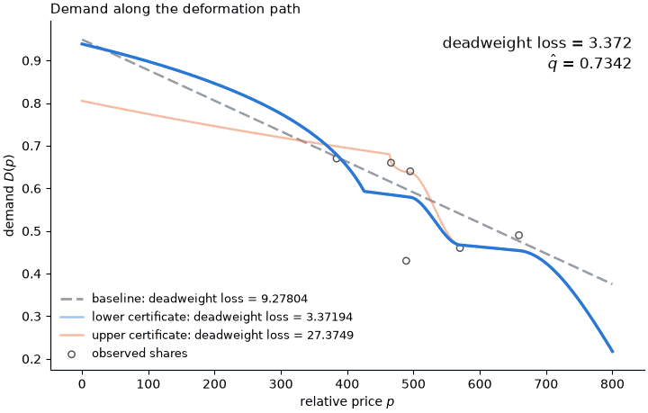

# Directed sensitivity: EFC2010

The object of interest is the deadweight loss $c(D)$ between demand and marginal cost from the competitive price $p_C$ to the efficient price $p_E$; the criterion is the employee-weighted squared share residual $\hat q(D)$ at the six observed prices; the working model $\mathcal{A}$ is linear demand $D_{a,b}(p) = a + bp$; and the nesting model $\mathcal{N}$ is all differentiable, strictly decreasing $D : [0, 800] \to [0,1]$ with nonnegative marginal cost and single crossing of marginal cost and price.
The filled template is [`../filled_template.md`](../filled_template.md); the code of this run is [`run.py`](run.py) and the Lean source is [`lean/EFC2010.lean`](lean/EFC2010.lean), and its outputs are [`certificates.json`](certificates.json), [`animation.gif`](animation.gif), [`certificates.png`](certificates.png), and this report.
The workflow was run by Claude Code on Claude Opus 5.5 (`claude-opus-5-5`) on 2026-10-14.

## 1. Results

| Direction | Object $c$ | Criterion $\hat q$ | Verified feasible? | Origin | Exact inf/sup? |
|---|---|---|---|---|---|
| Baseline | 9.28 | 0.734 | Yes | N/A | N/A |
| Lower | 3.37 | 0.734 | Yes | Analytic exploration | Yes |
| Upper | 27.4 | 0.734 | Yes | Analytic exploration | Yes |



## 2. Analytic exploration

Write $AC(p) = \gamma + \delta p$ with $\gamma = 391.6$ and $\delta = 0.1554$, so $p_C = \gamma/(1-\delta) = 463.7$; write $k = \delta/(1-\delta)$, $H = D \cdot AC$ for total cost, $G(p) = D(p)(p_C - p)^{-k}$ for $p < p_C$, and $p_1 = 384 < p_C < p_2 = 466 < \dots < p_6 = 659$ for the observed prices, with $d_j = D(p_j)$, weights $w_j$, and budget $\bar q = 0.734$.
Let

$$\Phi(a) = \frac{1}{\delta}\left[\ln\frac{p_C}{AC(a)} - \gamma\left(\frac{1}{AC(a)} - \frac{1}{p_C}\right)\right],$$

which is decreasing on $[0, p_C]$ with $\Phi(0) = -\ln(1-\delta)/\delta - 1 = 0.0868$.

1. **Reduction.** For $D \in \mathcal{N}$: $MC \ge 0$ if and only if $H$ is nonincreasing; for $p < p_C$, $MC(p) > p$ if and only if $\log G$ is strictly decreasing at $p$, so $G$ decreases on $[0, p_E)$ and is nondecreasing on $(p_E, p_C)$; and for every $a \in [0, p_C]$,

   $$J_a(D) := \int_a^{p_C} (p - MC(p)) \lvert D'(p) \rvert \mathrm{d}p = \int_a^{p_C} D(p) \mathrm{d}p - (1-\delta)(p_C - a) D(a),$$

   with $c(D) = J_{p_E}(D)$.
2. **Exact supremum.** $\sup c = \Phi(0) AC(p_1) \bar d_1 = 27.37$, where $\bar d_1 = 0.699$ is the largest $d_1$ compatible with $\hat q \le \bar q$ and nonincreasing $H$ at the data.
   It is attained by a demand curve with $MC \equiv 0$ on $[0, p_C]$.
3. **Exact infimum.** $\inf c = \min_h h \Phi(p^\ast) = 3.372$, attained in the reduced problem at $h = H(p_2) = 271.4$, $d_1 = 0.679$, and junction $p^\ast = 425.5$, where $p^\ast$ solves $d_1 ((p_C - p^\ast)/(p_C - p_1))^k = h / AC(p^\ast)$.
   It is not attained in $\mathcal{N}$.

The Lean source [`lean/EFC2010.lean`](lean/EFC2010.lean) compiles with no `sorry` and no axioms beyond `propext`, `Classical.choice` and `Quot.sound`.
It proves that $K \Phi(0)$ is the greatest value of $J_{p_E}$ over the relaxed set of Claim 2 (`upper_isGreatest`, `upper_sensitivity`), that the envelope of Claim 3 minimizes $J_{p_1}$ for fixed $d_1, h$ (`lower_isLeast`), and the closed form of $\Phi(0)$ (`unitLoss_zero_eq`).
Claim 1, the case $p_E > p_1$ of Claim 3, and the reduced minimizations over the data values are not formalized.

## 3. Basis model

Let $d^U$ and $d^L$ be the data values that solve the reduced problems of Claims 2 and 3 at budget $(1-\tau)\bar q$, and let $P^U$, $P^L$ be monotone cubic (PCHIP) interpolants of total cost through $(0, K)$, $(p_C, K)$ and $(p_j, d_j^U AC(p_j))$, and through $(0, h)$ and $(p_j, d_j^L AC(p_j))$, for $j \ge 2$, each closed by half its last value at 800, with $K = d_1^U AC(p_1)$ and $h = d_2^L AC(p_2)$.
The anchors are

$$\hat\nu_U(p) = \frac{e^{-\eta(p - p_1)} P^U(p)}{AC(p)},$$

$$\hat\nu_L(p) = \left(f_1(p)^r + f_2(p)^r\right)^{1/r},$$

where $f_1(p) = d_1^L (\max(p_C - p, 0)/(p_C - p_1))^k e^{-\eta'(p - p_1)}$ and $f_2(p) = e^{-\eta(p - p_2)} P^L(p) / AC(p)$, with $\tau = 10^{-5}$, $\eta = 10^{-9}$, $\eta' = 10^{-7}$ and $r = 10^4$.
Then

```math
\mathcal{B} = \left\lbrace \beta = |w| \hat\nu_{\mathrm{sgn}(w)} + (1-|w|) D_{a,b} : w \in [-1,1], D_{a,b} \in \mathcal{A}, \beta \in \mathcal{N} \right\rbrace,
```

where $\hat\nu_{+} = \hat\nu_U$ and $\hat\nu_{-} = \hat\nu_L$.

## 4. Numerical decisions

- The anchors leave a criterion slack of $\tau \bar q$ and carry tilts $\eta, \eta'$, so that $MC > 0$ and strict single crossing hold by design; at $w = \pm 1$ they give $c = 27.37$ and $3.372$.
- The lower reduced problem is a bounded scalar minimization over $h$ to $10^{-10}$ after a 401-point grid; a 20-start SLSQP over all six data values gives the same value, 3.372.
- The nesting-model restrictions are checked on a 3201-point price grid, with single crossing at tolerance $10^{-9}$.

## 5. Judgement calls

- The code scales the criterion by $1000/\sum_i n_i$ relative to the template's $\sum_i n_i (s_i - D(p_i))^2$; this leaves the feasible set unchanged, and all criterion values are on the code's scale.
- Differentiability of $D$ is taken as stated, without continuity of $D'$; the extremal curves are reached as limits of smooth curves, so neither bound depends on this choice.

## 6. Evaluation spend

Criterion 11914 of 100000; target 3005 of 100000.

## Appendix: proofs

**Claim 1.** $MC = AC + \delta D/D'$ and $H' = D' MC$ with $D' < 0$, so $MC \ge 0$ if and only if $H' \le 0$.
For $p < p_C$, $AC(p) - p = (1-\delta)(p_C - p)$, so $MC(p) > p$ is $\lvert D' \rvert / D > k/(p_C - p)$, which is $(\log G)' < 0$.
Single crossing makes $\lbrace MC > p \rbrace$ an initial segment ending at $p_E$, which gives the shape of $G$.
On $(a, p_C)$, $(p - MC)\lvert D' \rvert = -(1-\delta)(p - p_C) D' - \delta D$, and integrating $(p - p_C) D'$ by parts gives the identity.

**Claim 2.** Let $D$ be feasible and $K = H(p_1)$.
If $p_E \le p_1$, then $D \le H(p_E)/AC$ on $[p_E, p_1]$ and $D \le K/AC$ on $[p_1, p_C]$, so $c \le H(p_E)[A - X] + K B$ with $A = \int_{p_E}^{p_1} 1/AC$, $B = \int_{p_1}^{p_C} 1/AC$ and $X = (1-\delta)(p_C - p_E)/AC(p_E)$.
Since $A \le (p_1 - p_E)/AC(p_E)$ and $p_1 < \gamma$, $A - X < 0$; with $H(p_E) \ge K$ this gives $c \le K \Phi(p_E)$.
If $p_E > p_1$, then $c \le H(p_E)\Phi(p_E) \le K \Phi(p_E)$, since $\Phi(p_E) \ge 0$ and $H(p_E) \le K$.
In both cases $c \le K \Phi(0)$, because $\Phi$ is decreasing.
At the data, $d_1$ enters $\hat q$ only through $w_1 (s_1 - d_1)^2$ and through $H_1 \ge H_2$, so its largest value is $\bar d_1 = s_1 + \sqrt{(\bar q - R)/w_1} = 0.699$, where $R = 0.0983$ is the residual of the weighted nonincreasing fit of $s_j AC(p_j)$, $j \ge 2$; the constraint $H_1 \ge H_2$ is slack there, since $306.3 < 315.3$.
For attainment, $D = K/AC$ on $[0, p_C]$ continued by a monotone cubic in $H$ through the fitted tail lies in $\mathcal{N}$: $H$ is nonincreasing, $MC = 0$ below $p_C$, $p_E = 0$, and $D(0) = 0.805$.
It has $\hat q = \bar q$ and $c = K \Phi(0) = 27.37$.

**Claim 3.** In both cases $c \ge J_{p_1}(D)$: if $p_E \le p_1$ the integrand is nonnegative on $(p_E, p_1)$, and if $p_E > p_1$ it is negative on $(p_1, p_E)$.
If $p_E \le p_1$, $G$ is nondecreasing on $[p_1, p_C)$ and $H \ge H(p_2) = h$ there, so $D \ge m := \max(d_1 ((p_C - p)/(p_C - p_1))^k, h/AC)$ and $J_{p_1}(D) \ge J_{p_1}(m)$.
On $m$, $MC = p$ before the junction $p^\ast$ and $MC = 0$ after it, so $J_{p_1}(m) = h\Phi(p^\ast)$.
If $p_E > p_1$, the same argument from $p_E$ applies with $G(p_E) < G(p_1)$, which moves the junction earlier and gives a strictly larger bound.
The bound $h\Phi(p^\ast)$ falls in $d_1$ and rises in $h$, so for each $h$ it is minimized at $d_1 = s_1 + \sqrt{(\bar q - R(h))/w_1}$, where $R(h)$ is the least tail residual with $H_2 = h$.
Minimizing over $h$ gives 3.372.
For approach, the smooth maximum $(f_1^r + f_2^r)^{1/r}$ keeps $H$ nonincreasing and $G$ unimodal, and tends to $m$ as $r \to \infty$ and $\eta' \to 0$.
The bound is not attained: equality needs $D = m$ on $[p_1, p_C]$, but $m$ has a kink at $p^\ast$, because $k/(p_C - p^\ast) > \delta/AC(p^\ast)$.
