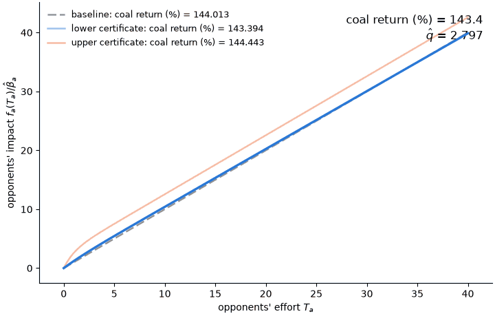

# Directed sensitivity: K2016

The object of interest $c$ is the coal coalition's average return to lobbying, in percent; the criterion $\hat q$ is the negative penalized simulated log-likelihood of Kang (2016) with all non-lobbying parameters held at Table 7; the working model $\mathcal{A}$ has linear impact functions $f_f(T) = \beta_f T$, $f_a(T) = \beta_a T$ and spending exponent $\gamma$; and the nesting model $\mathcal{N}$ allows any $C^1$, zero-at-zero, strictly increasing, concave $f_f, f_a$ with $\gamma \in (0,1)$.
The filled template is [`../filled_template.md`](../filled_template.md).
The code of this run is [`basis.py`](basis.py), [`search.py`](search.py), [`explore.py`](explore.py), the search scripts in [`steps/`](steps), and [`run.py`](run.py); its outputs are [`evaluations.jsonl`](evaluations.jsonl), [`certificates.json`](certificates.json), [`animation.gif`](animation.gif), [`certificates.png`](certificates.png), [`lean/K2016.lean`](lean/K2016.lean), and this report.
The workflow was run by a Claude Code subagent on Claude Opus 5.5 (`claude-opus-5-5`) on 2026-10-14.

## 1. Results

| Direction | Object $c$ | Criterion $\hat q$ | Verified feasible? | Origin | Exact inf/sup? |
|---|---|---|---|---|---|
| Baseline | 144.0 | 2.797 | Yes | N/A | N/A |
| Lower | 143.4 | 2.797 (slack 5.93e-5) | Yes | Basis model | No |
| Upper | 144.4 | 2.797 (slack 4.23e-5) | Yes | Basis model | No |



## 2. Analytic exploration

1. **Lower bound.** $c(\nu) \ge 0$ for every $\nu \in \mathcal{N}$, so the infimum over the feasible set is at least $0$.
   This bound is far from the lower certificate, 143.4.
2. **Mechanism for a sole lobbyist.** On a draw where coalition $\ell$ is the only participant, with effort $T = s^{\gamma}$ and impact $F = f(T)$, its return satisfies

   $$1 + \frac{b}{s + c_{\ell k}} = \frac{1}{\gamma} R_P R_f \frac{s}{s + c_{\ell k}},$$

   where $R_f = f(T)/(T f'(T)) \ge 1$ and $R_P \ge 1$.
   In $\mathcal{A}$, $R_f = 1$.
   In $\mathcal{N}$, concavity of $f$ at the efforts in use can only raise the return relative to a linear $f$ with the same $\gamma$.
3. No exact infimum or supremum, finite-dimensional reduction, or analytic upper bound was obtained.

Proofs are in the [Appendix: proofs](#appendix-proofs).
[`lean/K2016.lean`](lean/K2016.lean) compiles against the repository's `lean/` project with no `sorry` and no axioms.
It proves Claim 1 at the draw and aggregate levels (`return_nonneg`, `target_nonneg`) and the three inequalities behind Claim 2 (`mul_deriv_le_of_concave`, `gain_ge_marginal`, `sole_return_lower`).
The link from these lemmas to the simulation code is by inspection and is not formalized.

## 3. Basis model

With $B_\rho(x) = ((1+x)^\rho - 1)/\rho$, $\kappa = 500$, and $\hat\beta_f, \hat\beta_a$ the Table 7 slopes,

```math
\mathcal{B} = \left\lbrace (\gamma, f_f, f_a) : f_j(T) = \hat\beta_j e^{u_j} \left[\kappa B_{\rho_j}(T/\kappa) + \phi_j \lambda_j \left(1 - e^{-T/\lambda_j}\right)\right], \gamma \in (0,1), u_j \in \mathbb{R}, \rho_j \le 1, \phi_j \ge 0, \lambda_j > 0, j \in \lbrace f, a \rbrace \right\rbrace .
```

At $\rho_j = 1$ and $\phi_j = 0$ this is $\mathcal{A}$, and every member is $C^1$, zero at zero, strictly increasing, and concave, so $\mathcal{A} \subset \mathcal{B} \subset \mathcal{N}$.
Both certificates have $\rho_f = \rho_a = 1$ and $\phi_f = 0$.
The lower certificate has $(\gamma, u_f, u_a, \phi_a, \lambda_a) = (0.2898, -0.0127, -0.0178, 0.3, 2)$.
The upper certificate has $(\gamma, u_f, u_a, \phi_a, \lambda_a) = (0.2885, -0.0001, 0.0022, 2.51, 1.00)$.

## 4. Numerical decisions

- $\hat q$ is a step function of $\nu$, because each draw counts only if its selected participation profile matches the observed one.
  Perturbations of about $3 \times 10^{-5}$ in $\gamma$ move $\hat q$ by about $10^{-4}$, the same order as the fit differences that decide feasibility, so both certificates are partly lucky draws of this roughness.
- Feasibility uses zero tolerance: $\hat q \le \bar q$ exactly, with $\bar q = 2.79725044$.
- The search combined a quadratic model of $\hat q$ and $c$ in the working-model coordinates with an opponent-side bump and random jitter, and kept the most extreme feasible points.

## 5. Judgement calls

- A 40-point local random search in $\mathcal{A}$ found $(\gamma, u_f, u_a) = (0.288509, -3.0 \times 10^{-5}, 9.5 \times 10^{-5})$ with $\hat q = 2.7972504$, which is the baseline used here; $c$ changes by less than 0.01.
- The search fixed $\kappa = 500$ and the bump on the supporters' side at $\phi_f = 0$, because Box-Cox curvature on either side and supporter-side bumps raised $\hat q$ in one-sided scans at the baseline, while opponent-side bumps with $\lambda_a \le 6$ lowered it.

## 6. Evaluation spend

Criterion 350 of 2,000; target 350 of 2,000.

## Appendix: proofs

**Claim 1.** On a matched draw the selected participation profile is a pure-strategy equilibrium of the entry game, so coal's payoff there is at least its payoff at the profile without coal, with the others' efforts re-solved.
That difference is the net benefit $b$, so $b \ge 0$, and the denominator is at least the entry cost $c_{\ell k} > 0$, so each ratio is nonnegative.
An average over matched draws, then over policies, times 100, is nonnegative, and $c = 0$ when $K$ is empty.

**Claim 2.** With $\ell$ the only participant, removing it leaves no lobbying, so $\bar P^{-\ell} = \pi$.
For a supporter, $P(F) = (\pi + F)/(1 + F)$, and the first-order condition $1 = \gamma v P'(F) f'(T) s^{\gamma - 1}$ gives $s = \gamma v P'(F) T f'(T)$.
Then $1 + b/(s + c_{\ell k}) = (P(F) - \pi) v/(s + c_{\ell k})$, which equals the display with $R_P = (P(F) - \pi)/(F P'(F))$ and $R_f = F/(T f'(T))$.
Concavity of $f$ with $f(0) = 0$ gives $f(T)/T \ge f'(T)$, so $R_f \ge 1$, with equality when $f$ is linear on $[0, T]$.
Also $P(F) - \pi = F(1 - \pi)/(1 + F) \ge F(1 - \pi)/(1 + F)^2 = F P'(F)$, so $R_P \ge 1$.
For an opponent, $P = \pi/(1 + A)$ and $\pi - P = \pi A/(1 + A) \ge \pi A/(1 + A)^2 = A(-P_a)$, and the same steps apply with $\lvert v \rvert$.
