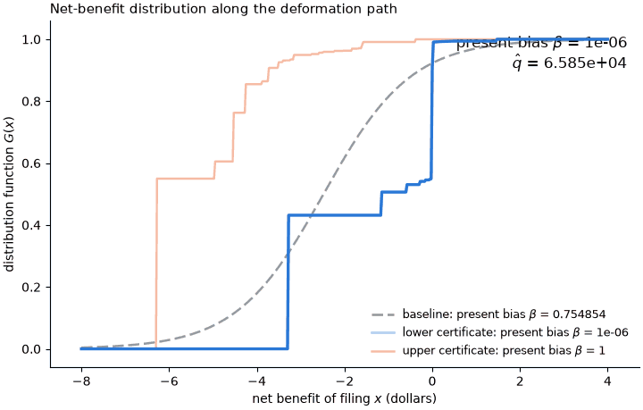

# Directed sensitivity: present bias in tax filing

The object of interest is the present bias $c(\nu) = \beta$ of a naive quasi-hyperbolic filer; the criterion $\hat q$ is the negative log-likelihood of the daily filing decisions over the 65 decision days; the working model has a logistic daily net benefit of filing with unit scale and mean $-\kappa$; and the nesting model allows any $\beta \in (0, 1]$ and any net-benefit distribution $G$ with mass in $[-25, 25]$ and $\mathbb{E}[X] \le 0$.
The filled template is [`../filled_template.md`](../filled_template.md).
The code of this run is [`run.py`](run.py), [`basis.py`](basis.py) and [`lean/MMS2023.lean`](lean/MMS2023.lean), and its outputs are [`certificates.json`](certificates.json), [`animation.gif`](animation.gif), [`certificates.png`](certificates.png), and this report, all in `applications/MMS2023/output/`.
The workflow was run by Claude Code on Claude Opus 5.5 (`claude-opus-5-5`) on 2026-10-14.

## 1. Results

| Direction | Object $c$ | Criterion $\hat q$ | Verified feasible? | Origin | Exact inf/sup? |
|---|---|---|---|---|---|
| Baseline | 0.755 | 66291 | Yes | N/A | N/A |
| Lower | 1.00e-6 | 65847 | Yes | Analytic exploration | Yes |
| Upper | 1 | 65847 | Yes | Analytic exploration | Yes |

## 2. Analytic exploration

Write $p_t$ for the filing hazard on day $t$, $p^\ast$ for the isotonic (pool-adjacent-violators) fit of the observed hazards $f_t / n_t$ with weights $n_t$, and $\bar q = 66291$ for the budget.

1. **Reduction.** For every $\nu \in \mathcal{N}$, $\hat q(\nu)$ depends on $\nu$ only through $(p_0, \dots, p_{64})$, and this sequence is nondecreasing in $t$.
   Hence $\hat q \ge \hat q(p^\ast) = 65847$ on $\mathcal{N}$.
2. **Observational equivalence.** For every $\beta \in (0, 1]$ and every nondecreasing $p \in (0, 1)^{65}$ with $-24 (1 - p_{64}) + 25 p_{64} \le 0$, there is a law $G$ with at most 66 atoms in $[-24, 25]$ and $\mathbb{E}[X] \le 0$ such that $(\beta, G) \in \mathcal{N}$ has hazards exactly $p$.
3. **Exact solution.** The values of $c$ over the feasible set are exactly $(0, 1]$: the supremum is 1 and is attained, and the infimum is 0 and is not attained.
   Every feasible certificate fits as well as $p^\ast$, $444$ better than the baseline.

Proofs are in the [Appendix: proofs](#appendix-proofs).
The Lean source [`lean/MMS2023.lean`](lean/MMS2023.lean) compiles against [`lean/`](../../../lean) with no `sorry`, using only the axioms `propext`, `Classical.choice` and `Quot.sound`.
It proves Claim 2 for discrete laws (`realize`, by Knaster–Tarski) and Claim 3 (`present_bias_sensitivity`) for the discrete laws of $\mathcal{N}$ and any criterion that reads only the hazards.
Its hypotheses on $p^\ast$ (nondecreasing, $p^\ast_0 > 0$, $p^\ast_{64} < 1$, the mean condition, and $\hat q(p^\ast) \le \bar q$) are checked numerically in `run.py`.
Claim 1 and the floating-point likelihood are not formalized.

## 3. Basis model

Let $p_{\beta,\kappa}$ be the hazards of $(\beta, G_\kappa)$, and let $v_k$ be the continuation value $k$ days before the deadline, so that the threshold on day $64 - k$ is $\beta v_k$.
For $\beta \in [10^{-6}, 1]$, $\kappa \ge 0$, $w \in [0, 1]$ and $s \in [0, 1]$,

$$\mathcal{B} = \left\lbrace \left(\beta, (1 - w) G_\kappa + w H_{\beta,\kappa,w,s}\right) \right\rbrace \cap \mathcal{N},$$

where $H_{\beta,\kappa,w,s}$ puts one atom at $`\mathbb{E}_{G_\kappa}[X \mid X \in C]`$ on each cell $C$ cut from $\mathbb{R}$ by the points $\lbrace v_k \rbrace \cup \lbrace \beta v_k \rbrace$.
The atom's mass is $G_\kappa(C)$, rescaled within each cell between consecutive thresholds so that the hazards equal $(1 - ws) p_{\beta,\kappa} + ws p^\ast$.
The values $v$ solve the continuation-value recursion of the mixture as a fixed point.
At $w = 0$ this is $\mathcal{A}$, and the certificates are at $(\beta, \hat\kappa, 1, 1)$ with $\beta \in \lbrace 10^{-6}, 1 \rbrace$.

## 4. Numerical decisions

- The basis model and the solver floor $\beta$ at $10^{-6}$, because the infimum 0 is not attained; the lower certificate sits at the floor.
- The basis fixed point is iterated to a sup-norm change of $10^{-13}$, and complement masses above $-10^{-12}$ but below zero are set to zero and renormalized.

## 5. Judgement calls

- The analytic twin puts atoms at $-24$ and $25$ and middle atoms halfway between consecutive thresholds; any atoms in $(-25, 0]$ and $[0, 25]$ that meet the mean condition would do.
- The certificates reproduce $p^\ast$ rather than the baseline's own hazards, so they fit strictly better than the baseline instead of tying with it.
- The solver started at $(\hat\beta, \hat\kappa, 1, 1/2)$, the end of the path's first leg, because its walk toward lower $\beta$ stalled at the estimate, where the fit constraint binds.

## 6. Evaluation spend

473 evaluations of $\hat q$ and 338 of $c$; no limits were set.

## Appendix: proofs

**Claim 1.** Let $u_{65} = \mathbb{E}[X]$ and $u_t = \mathbb{E}[\max(X, u_{t+1})]$.
Since $\mathbb{E}[X \mathbf{1}\lbrace X > y \rbrace] + G(y) y = \mathbb{E}[\max(X, y)]$, induction from $w_{64} = \beta u_{65}$ gives $w_t = \beta u_{t+1}$.
As $\max(X, u) \ge u$, $u_t \ge u_{t+1}$, so $w_t$ is nonincreasing in $t$ and $p_t = 1 - G(w_t)$ is nondecreasing.
$\hat q$ is a function of $p$ by definition, and its minimum over nondecreasing $p$ is attained at $p^\ast$.

**Claim 2.** Fix $\beta$ and $p$, let $P_k = p_{64-k}$, and let $a = -24$ and $b = 25$.
For $v \in [a, b]^{65}$, let $H_v$ put mass $1 - P_0$ on $a$, mass $P_{i-1} - P_i$ on $\beta(v_i + v_{i-1})/2$ for $i = 1, \dots, 64$, and mass $P_{64}$ on $b$.
The masses are nonnegative and sum to one, and the atoms lie in $[a, b]$, since $\beta y \in [a, b]$ for $y \in [a, b]$ when $a \le 0 \le b$.
Let $\Phi(v)$ be the continuation values of $H_v$, with $`\Phi(v)_0 = \mathbb{E}[X]`$ and $`\Phi(v)_{k+1} = \mathbb{E}[\max(X, \Phi(v)_k)]`$.
Then $\Phi$ maps the box into itself and is monotone, because the atoms rise with $v$, so Knaster–Tarski gives a fixed point $v$.
At this point $v_k < b$, since $a < b$ carries mass $1 - P_0 > 0$, and $v_{k+1} - v_k \ge P_{64}(b - v_k) > 0$, so $v$ is strictly increasing.
Middle atom $i$ then lies in $(\beta v_{i-1}, \beta v_i]$, atom $a$ lies at or below every threshold, and atom $b$ lies above every threshold.
Hence $`G(\beta v_k) = 1 - P_0 + \sum_{i=1}^{k} (P_{i-1} - P_i) = 1 - P_k`$, so the hazard $k$ days before the deadline is $P_k$.
Finally $\mathbb{E}[X] \le (1 - P_0) a + P_0 b \le 0$, and the atoms lie in $(-25, 25]$, so the tail conditions of $\mathcal{N}$ hold exactly.

**Claim 3.** Every $\nu \in \mathcal{N}$ has $0 < \beta \le 1$.
$p^\ast$ is nondecreasing with $p^\ast_0 = 0.00925$ and $p^\ast_{64} = 0.45$, and $-24(0.55) + 25(0.45) = -1.95 \le 0$.
By Claims 1 and 2, every $\beta \in (0, 1]$ then has a primitive in $\mathcal{N}$ with $\hat q = 65847 \le \bar q$.
So the feasible values of $c$ are $(0, 1]$: 1 is attained, and 0 is approached but not attained.
