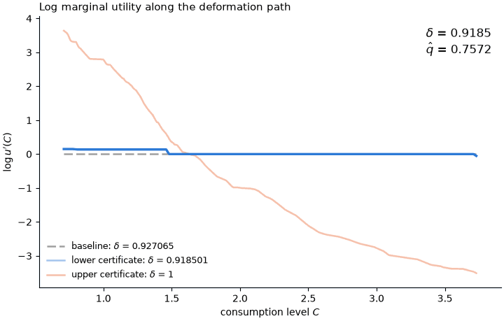

# Directed sensitivity: SW2000

The object of interest is the discount factor $c(\nu) = \delta$; the criterion is the continuously updated GMM objective $\hat q$ of the consumption Euler equation with instruments $(1, x_{t-1}, R_{t-1})$ and a one-lag Newey-West weight, over 1891 to 1985; the working model is CRRA marginal utility $(C/\bar C)^{-\gamma}$ with $0 < \gamma \le 10$ and $0 < \delta \le 1$; and the nesting model is every continuously differentiable, positive marginal utility on $L = [0.71, 3.73]$ normalized at $\bar C$ with relative risk aversion in $(0, 10]$, with $0 < \delta \le 1$.
The filled template is [`../filled_template.md`](../filled_template.md); the code of this run is [`run.py`](run.py), and its outputs are [`certificates.json`](certificates.json), [`animation.gif`](animation.gif), [`certificates.png`](certificates.png), and [`lean/SW2000.lean`](lean/SW2000.lean).
The workflow was run by Claude Code on Claude Opus 5.5 (`claude-opus-5-5`) on 2026-10-14.

## 1. Results

| Direction | Object $c$ | Criterion $\hat q$ | Verified feasible? | Origin | Exact inf/sup? |
|---|---|---|---|---|---|
| Baseline | 0.927 | 0.757 | Yes | N/A | N/A |
| Lower | 0.919 | 0.757 | Yes | Basis model | No |
| Upper | 1 | 6.29e-19 | Yes | Analytic exploration | Yes |

## 2. Analytic exploration

Let $c_1 < \dots < c_{82}$ be the distinct consumption levels in the data, so $L = [c_1, c_{82}]$, let $h_k = \log(c_{k+1}/c_k)$, and let $A$ be the $95 \times 81$ matrix with $A_{tk} = \pm 1$ when gap $[c_k, c_{k+1}]$ lies between $C_{t-1}$ and $C_t$, signed as $x_t - 1$, and $A_{tk} = 0$ otherwise.
Write $\bar q = \hat q(\hat\alpha) = 0.757$.

1. **Reduction.** For $\nu \in \mathcal{N}$ let $\psi_k(\nu) = \log u^{\prime}(c_k) - \log u^{\prime}(c_{k+1})$.
   Then $\psi_k \in (0, 10 h_k]$, and $u^{\prime}(C_t)/u^{\prime}(C_{t-1}) = \exp(-(A\psi)_t)$, so $c$ and $\hat q$ depend on $\nu$ only through $(\delta, \psi)$.
   Conversely every $(\delta, \psi) \in (0,1] \times \prod_k (0, 10 h_k]$ is attained by some $\nu \in \mathcal{N}$.
   The problem is therefore to extremize $\delta$ over the 82-dimensional set $\lbrace (\delta, \psi) \in (0,1] \times \prod_k (0, 10 h_k] : \tilde q(\delta, \psi) \le \bar q \rbrace$, where $\tilde q$ is $\hat q$ with ratios $\exp(-A\psi)$.
2. **Exact supremum.** Over the feasible set, $\sup c = \max c = 1$.
   It is attained by the upper certificate, which has $\delta = 1$ and $\hat q = 6.29 \times 10^{-19} \le \bar q$.
3. **Lower side.** No exact infimum and no informative analytic lower bound was obtained; the infimum was searched numerically in the reduced problem of Claim 1.
4. **Nesting of the basis model.** For $w \in [0,1]$, a mixture $w \nu_1 + (1-w) \nu_2$ of two primitives in $\mathcal{N}$, mixing $\delta$ and $u^{\prime}$ linearly, lies in $\mathcal{N}$.

Proofs are in the [Appendix: proofs](#appendix-proofs).
The Lean source [`lean/SW2000.lean`](lean/SW2000.lean) compiled without `sorry` or new axioms.
It formalizes the bound $\psi_k \in (0, 10 h_k]$ of Claim 1 (`increment_bounds`), Claim 2 from the cap $\delta \le 1$ and a feasible primitive with $\delta = 1$ (`upper_is_one`), and the risk-aversion bound behind Claim 4 (`mixture_rra_bounds`).
The converse half of Claim 1 and the numerical fact that the upper certificate has $\hat q \le \bar q$, which enters `upper_is_one` as a hypothesis, are not formalized.

## 3. Basis model

With $v = \log C$, $v_k = \log c_k$, $\tau = 10^{-3}$, $\underline\rho = 10^{-9}$ and $\bar\rho = 10 - 10^{-9}$, let $\theta = (\delta_\theta, p) \in (0,1] \times [\underline\rho, \bar\rho]^{81}$.
Let $r_p$ be piecewise linear in $v$ with nodes $v_k$, $v_k + \tau h_k$, $v_{k+1} - \tau h_k$, $v_{k+1}$ and values $\kappa_k$, $p_k$, $p_k$, $\kappa_{k+1}$ on each gap, where $\kappa_k = (p_{k-1} + p_k)/2$ for interior knots, $\kappa_1 = p_1$ and $\kappa_{82} = p_{81}$.
The anchor is $`\hat\nu(\theta) = (\delta_\theta, u^{\prime}_\theta)`$ with relative risk aversion $r_p$, that is

$$u^{\prime}_\theta(C) = \exp\left(-\int_{\log \bar C}^{\log C} r_p(v) \mathrm{d}v\right).$$

Then

$$\mathcal{B} = \left\lbrace \beta = w \hat\nu(\theta) + (1-w) \alpha : w \in [0,1], \theta \in \Theta, \alpha \in \mathcal{A} \right\rbrace ,$$

mixing $\delta$ and $u^{\prime}$ linearly, so $\mathcal{A} \subset \mathcal{B} \subset \mathcal{N}$ by Claim 4.
Both certificates have $w = 1$.

## 4. Numerical decisions

- In the basis model relative risk aversion is confined to $[10^{-9}, 10 - 10^{-9}]$, and the ramps take a share $\tau = 10^{-3}$ of each gap; the floor equals the baseline $\hat\gamma$, and the ceiling margin keeps the grid check of $\rho \le 10$ from failing on rounding.
- The lower certificate is the best of SLSQP runs on the $w = 1$ slice with an analytic gradient of $\hat q$, from 40 starts (seed 20000) and then 81 restarts each flipping one plateau of the best between floor and ceiling, with the fit constraint tightened by $10^{-12}$.
  97 of 121 runs ended feasible, the best value 0.9185 recurred across starts, and no flip improved it; this is not a proof of global optimality.
- The upper certificate minimizes $\hat q$ over $p$ at $\delta_\theta = 1$ by L-BFGS-B.
- The nesting restrictions are checked by `specification.py:ConstraintSet` on `specification.py:LEVEL_GRID`, 20,001 points plus the observed levels.

## 5. Judgement calls

- The baseline is `output/estimate.json`, with $\hat\gamma = 10^{-9}$ at the lower bound of the estimation code; profiling $\hat q$ over 101 values of $\gamma \in (0, 10]$ found no lower criterion in $\mathcal{A}$, and since the template requires $\gamma > 0$ the working model's infimum is approached at $\gamma \to 0$ rather than attained.

## 6. Evaluation spend

Criterion 46,844 of 100,000; target 50 of 100,000.

## Appendix: proofs

**Claim 1.** Let $\Phi = -\log u^{\prime}$, so $\Phi^{\prime}(C) = \rho(C)/C$ is continuous on $L$.
Then $`\psi_k = \int_{c_k}^{c_{k+1}} \rho(s)/s \mathrm{d}s`$, and $0 < \rho \le 10$ gives $0 < \psi_k \le 10 h_k$.
By telescoping, $`\log u^{\prime}(C_t) - \log u^{\prime}(C_{t-1}) = -(\Phi(C_t) - \Phi(C_{t-1})) = -(A\psi)_t`$.
Conversely, given $\psi$, on gap $k$ take $\rho$ piecewise linear in $v$, equal to 10 at both knots, ramping linearly over a share $\eta$ of the gap to a plateau $\varepsilon_k$; its integral in $v$ is $h_k(10\eta + (1-\eta)\varepsilon_k)$.
Choose $\eta$ with $10 \eta h_k < \psi_k$ for all $k$ and set $\varepsilon_k = (\psi_k/h_k - 10\eta)/(1-\eta)$, which lies in $(0, 10]$.
Then $\rho$ is continuous with values in $(0, 10]$, and $u^{\prime}(C) = \exp(-\int_{\log \bar C}^{\log C} \rho(e^v) \mathrm{d}v)$ is continuously differentiable, positive, equal to 1 at $\bar C$, has relative risk aversion $\rho$, and realizes $\psi$; $\delta$ is free in $(0,1]$.

**Claim 2.** Every $\nu \in \mathcal{N}$ has $\delta \le 1$.
The upper certificate lies in $\mathcal{B} \subset \mathcal{N}$ by Claim 4, has $\delta = 1$, and has $\hat q = 6.29 \times 10^{-19} \le \bar q$, evaluated in floating point by `specification.py:Criterion`, so it is feasible and attains the bound.

**Claim 3.** Nothing to prove.

**Claim 4.** Let $u^{\prime} = w u^{\prime}_1 + (1-w) u^{\prime}_2$.
It is continuously differentiable, positive, and equal to 1 at $\bar C$, and $\delta = w \delta_1 + (1-w) \delta_2 \in (0, 1]$.
Its relative risk aversion is $(w u^{\prime}_1 \rho_1 + (1-w) u^{\prime}_2 \rho_2) / (w u^{\prime}_1 + (1-w) u^{\prime}_2)$, a weighted average of $\rho_1, \rho_2 \in (0, 10]$ with nonnegative weights summing to one, so it lies in $(0, 10]$.
