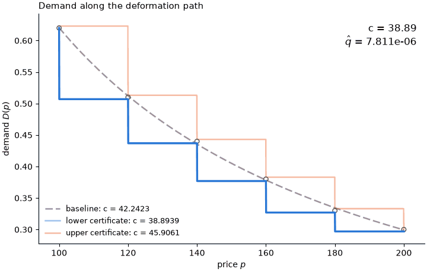

# Directed sensitivity: consumer surplus loss under isoelastic demand

The object of interest is the consumer surplus loss $c(D)=\int_{100}^{200} D(p) \mathrm{d}p$ from a price increase from 100 to 200; the criterion is the mean squared gap $\hat q(D)$ between the six observed shares and demand at the observed prices; the working model is the isoelastic family $D_{a,b}(p)=\exp(a-b\log p)$ with $b>0$ and $a \le b\log 100$; and the nesting model is all continuous, strictly decreasing $D:[100,200]\to[0,1]$.
The filled template is [`../filled_template.md`](../filled_template.md); the code of this run is [`run.py`](run.py), and its outputs are [`certificates.json`](certificates.json), [`animation.gif`](animation.gif), [`certificates.png`](certificates.png), and this report.
The workflow was run on Claude Opus 5.5 (`claude-opus-5-5`) on 2026-10-14.

## 1. Results

| Direction | Object $c$ | Criterion $\hat q$ | Verified feasible? | Origin | Exact inf/sup? |
|---|---|---|---|---|---|
| Baseline | 42.2 | 7.81e-6 | Yes | N/A | N/A |
| Lower | 38.9 | 7.81e-6 | Yes | Analytic exploration | Yes |
| Upper | 45.9 | 7.81e-6 | Yes | Analytic exploration | Yes |



## 2. Analytic exploration

Write $p_i = 80 + 20i$ and $s_i$ for the observed prices and shares, $i=1,\dots,6$, so that $p_1 = P_0$ and $p_6 = P_1$; write $d_i = D(p_i)$ and $\bar q = \hat q(\hat\alpha) = 7.81 \times 10^{-6}$.

1. **Reduction.** For every $D \in \mathcal{N}$, $\hat q(D)$ depends on $D$ only through $d = (d_1,\dots,d_6)$, and $20\sum_{i=2}^{6} d_i < c(D) < 20\sum_{i=1}^{5} d_i$.
2. **Exact supremum.** Over the feasible set, $\sup c = 20\sum_{i=1}^{5} s_i + 20\sqrt{30\bar q} = 45.9$, and no feasible $D$ attains it.
3. **Exact infimum.** Over the feasible set, $\inf c = 20\sum_{i=2}^{6} s_i - 20\sqrt{30\bar q} = 38.9$, and no feasible $D$ attains it.

Proofs are in the [Appendix: proofs](#appendix-proofs).
No Lean formalization was requested.

## 3. Basis model

With $r = (1-\tau)\sqrt{6\bar q/5}$, let $d^U = s + r(1,1,1,1,1,0)$ and $d^L = s - r(0,1,1,1,1,1)$.
Let $\hat\nu_U$ be the piecewise-linear interpolant of the knots $(p_i, d^U_i)$ and $(p_{i+1}-\delta, d^U_i - \eta(20-\delta))$ for $i \le 5$, and $(p_6, d^U_6)$.
Let $\hat\nu_L$ be the piecewise-linear interpolant of the knots $(p_i, d^L_i)$ and $(p_i+\delta, d^L_{i+1} + \eta(20-\delta))$ for $i \le 5$, and $(p_6, d^L_6)$.
Here $\tau = 10^{-6}$, $\eta = 10^{-8}$ and $\delta = 10^{-4}$.
Then

```math
\mathcal{B} = \left\lbrace \beta_{w,a,b} = |w| \hat\nu_{\mathrm{sgn}(w)} + (1-|w|) D_{a,b} : w \in [-1,1], b > 0, a \le b\log P_0 \right\rbrace,
```

where $\hat\nu_{+} = \hat\nu_U$ and $\hat\nu_{-} = \hat\nu_L$.

## 4. Numerical decisions

- The anchors use $\tau = 10^{-6}$, $\eta = 10^{-8}$ and $\delta = 10^{-4}$.

## 5. Judgement calls

- Monotonicity is checked as a nonnegative minimum forward difference on a 2001-point price grid and the range at the two endpoints.

## 6. Evaluation spend

2458 evaluations of $\hat q$ and 804 of $c$.

## Appendix: proofs

**Claim 1.** $\hat q$ evaluates $D$ only at $p_1,\dots,p_6$.
On $[p_i, p_{i+1}]$ a strictly decreasing $D$ satisfies $d_{i+1} \le D(p) \le d_i$ with strict inequality on the interior, so by continuity $20 d_{i+1} < \int_{p_i}^{p_{i+1}} D < 20 d_i$.
Summing over $i = 1,\dots,5$ gives the claim, since $p_1 = P_0$ and $p_6 = P_1$.

**Claim 2.** Feasibility means $\lVert d - s \rVert^2 \le 6\bar q$.
By Claim 1 and Cauchy–Schwarz, $c(D) < 20\sum_{i \le 5} s_i + 20\sum_{i \le 5}(d_i - s_i) \le 20\sum_{i \le 5} s_i + 20\sqrt{5}\lVert d - s \rVert \le 20\sum_{i \le 5} s_i + 20\sqrt{30\bar q}$, so the bound holds and is not attained.
For approach, the anchor $\hat\nu_U$ of [Basis model](#3-basis-model) is continuous and strictly decreasing, because $s_i - s_{i+1} \ge 0.03 > 20\eta$; it maps into $[0,1]$, because $d^U_1 = 0.623$ and $d^U_6 = 0.3$; and $\hat q(\hat\nu_U) = (1-\tau)^2 \bar q \le \bar q$.
Its integral is $20\sum_{i \le 5} d^U_i - O(\eta + \delta)$, which tends to the bound as $\tau, \eta, \delta \to 0$.

**Claim 3.** Symmetric to Claim 2: $c(D) > 20\sum_{i \ge 2} s_i - 20\sqrt{5}\lVert d - s \rVert \ge 20\sum_{i \ge 2} s_i - 20\sqrt{30\bar q}$, and $\hat\nu_L$, with $d^L_1 = 0.62$ and $d^L_6 = 0.297$, is feasible and approaches the bound as $\tau, \eta, \delta \to 0$.
