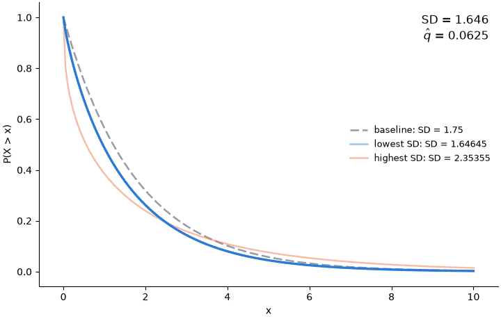

# Directed sensitivity: exponential

The object of interest is the population standard deviation $c(\nu) = \mathrm{SD}(\nu)$; the criterion is the weighted moment loss $\hat q(\nu) = (1-w)(m - \mathrm{E}\nu)^2 + w(s - \mathrm{SD}\nu)^2$ at $m = 1.5$, $s = 2$, $w = 0.5$; the working model $\mathcal{A}$ is the exponential family, which forces $\mathrm{SD} = \mathrm{E}$; and the nesting model $\mathcal{N}$ is every distribution on $(0, \infty)$ with a finite, strictly positive mean and standard deviation.
The filled template is [`filled_template.md`](../filled_template.md); this run is produced by [`workflow.py`](workflow.py) and writes [`report.md`](report.md), [`certificates.json`](certificates.json), [`animation.gif`](animation.gif), and [`certificates.png`](certificates.png) to `workflow/examples/exponential/output/`. 
The workflow was run on Claude Opus 5.5 (`claude-opus-5-5`) on 2026-10-14.

## 1. Results

| Direction | Object $c$ | Criterion $\hat q$ | Verified feasible? | Origin | Exact inf/sup? |
|---|---|---|---|---|---|
| Baseline | 1.75 | 0.0625 | Yes | N/A | N/A |
| Lower | 1.65 | 0.0625 | Yes | Analytic exploration | Yes |
| Upper | 2.35 | 0.0625 | Yes | Analytic exploration | Yes |

## 2. Analytic exploration

**Claim 1 (reduction to the moment plane).** Both $c$ and $\hat q$ read $\nu$ only through $T(\nu) = (\mathrm{E}\nu, \mathrm{SD}\nu)$, and $T(\mathcal{N}) = (0,\infty)^2$.
The problem is therefore equivalent to a two-dimensional one in $(\mu, \sigma)$, with $c = \sigma$ and

$$\hat q(\mu, \sigma) = (1-w)(m - \mu)^2 + w(s - \sigma)^2 .$$

**Claim 2 (budget).** $\hat q$ restricted to $\mathcal{A}$ is minimised at $\hat\alpha = (1-w)m + ws = 1.75$, with

$$\bar q = w(1-w)(s-m)^2 = 0.0625 .$$

The budget is exactly the squared distance from the data point $(m,s)$ to the diagonal $\lbrace \mu = \sigma \rbrace$ in the metric $\hat q$ induces, so the feasible set is the $\hat q$-ball around $(m,s)$ that the working model touches at $\hat\alpha$ and nowhere else.

**Claim 3 (exact solution).** The extreme values of $c$ over $\lbrace \nu \in \mathcal{N} : \hat q(\nu) \le \bar q \rbrace$ are

$$\min c = s - \lvert s - m \rvert \sqrt{1-w} = 1.65, \qquad \max c = s + \lvert s - m \rvert \sqrt{1-w} = 2.35 ,$$

each attained, and each at a primitive whose mean equals $m$.
Under the template's tolerance, $\hat q \le \bar q + 10^{-10}$, both widen by $2.8 \times 10^{-10}$.

No Lean formalization was requested, and none was attempted.

## 3. Basis model

With $\Gamma(k, \theta)$ the gamma distribution of shape $k$ and scale $\theta$, and $\hat\sigma_L, \hat\sigma_U$ the extreme standard deviations of Claim 3,

$$\mathcal{B} = \left\lbrace \Gamma\left(\frac{\mu^2}{\sigma^2}, \frac{\sigma^2}{\mu}\right) : (\mu, \sigma) = t (m, \hat\sigma) + (1-t)(\alpha, \alpha), t \in [0,1], \alpha > 0, \hat\sigma \in \lbrace \hat\sigma_L, \hat\sigma_U \rbrace \right\rbrace .$$

At $t = 0$ this is $\Gamma(1, \alpha) = \text{Exponential}(\alpha)$, so $\mathcal{A} \subseteq \mathcal{B} \subseteq \mathcal{N}$; at $t = 1$ it is the anchor of Claim 3.
The deformation weight is written $t$ because the template already uses $w$.

## 4. Numerical decisions

- Both solvers were capped at 25 iterations.

## 5. Judgement calls

- The template pins the moments of a certificate but not its distribution.
  Gamma was chosen to realize them because it contains the exponential family at shape one and attains every $(\mu, \sigma) \in (0,\infty)^2$; any other distribution with the same two moments is an equally valid certificate.

## 6. Evaluation spend

Criterion 2676 of 5000; target 562 of 5000.

## Appendix: proofs

**Claim 1.** $c(\nu) = \mathrm{SD}(\nu)$ and $\hat q(\nu)$ are functions of $(\mathrm{E}\nu, \mathrm{SD}\nu)$ by inspection, so both factor through $T$.
The definition of $\mathcal{N}$ gives $T(\mathcal{N}) \subseteq (0,\infty)^2$.
For the converse, fix $(\mu, \sigma) \in (0,\infty)^2$ and take $\Gamma(k, \theta)$ with $k = \mu^2/\sigma^2$ and $\theta = \sigma^2/\mu$: it is supported on $(0,\infty)$, has mean $k\theta = \mu$ and standard deviation $\sqrt{k} \theta = \sigma$, both finite and strictly positive, so it lies in $\mathcal{N}$ and $T$ maps it to $(\mu, \sigma)$.

**Claim 2.** On $\mathcal{A}$ the criterion is $\hat q(\alpha) = (1-w)(m-\alpha)^2 + w(s-\alpha)^2$, strictly convex with derivative $-2(1-w)(m-\alpha) - 2w(s-\alpha)$, which vanishes only at $\hat\alpha = (1-w)m + ws$.
Substituting $m - \hat\alpha = w(m-s)$ and $s - \hat\alpha = (1-w)(s-m)$ gives $\hat q(\hat\alpha) = (1-w)w^2(s-m)^2 + w(1-w)^2(s-m)^2 = w(1-w)(s-m)^2$.
At $m = 1.5$, $s = 2$, $w = 0.5$ this is $\hat\alpha = 1.75$ and $\bar q = 0.0625$, matching the template's estimate.
The same substitution shows $\bar q = \min_{\mu = \sigma} \hat q(\mu, \sigma)$, which is the tangency statement.

**Claim 3.** By Claim 1 the feasible set is $\lbrace (\mu, \sigma) \in (0,\infty)^2 : (1-w)(\mu - m)^2 + w(\sigma - s)^2 \le \bar q \rbrace$.
Any feasible point satisfies $w(\sigma - s)^2 \le \bar q$, hence

$$\lvert \sigma - s \rvert \le \sqrt{\bar q / w} = \lvert s - m \rvert \sqrt{1 - w} ,$$

using Claim 2 for $\bar q$.
Both ends are attained at $\mu = m > 0$, where the first term vanishes and the constraint holds with equality; and $\sigma = s \pm \lvert s-m \rvert \sqrt{1-w} > 0$ here because $\lvert s - m \rvert \sqrt{1-w} = 0.354 < 2 = s$, so the positivity restrictions do not bind.
Since both ends belong to $T(\mathcal{N})$ by Claim 1, they are a minimum and a maximum of $c$ over the feasible set.
Replacing $\bar q$ by $\bar q + 10^{-10}$ multiplies the half-width by $\sqrt{1 + 10^{-10}/\bar q}$, which moves each end by $2.8 \times 10^{-10}$.
